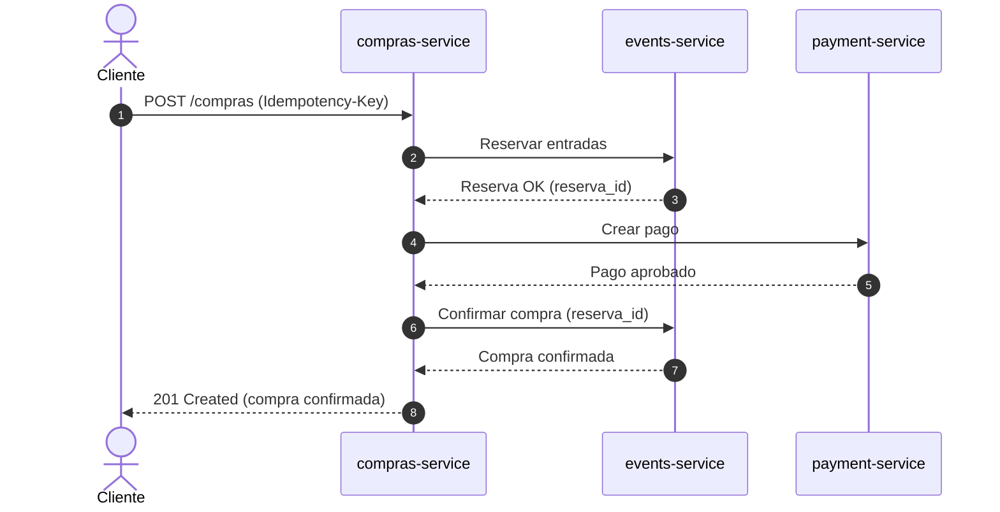
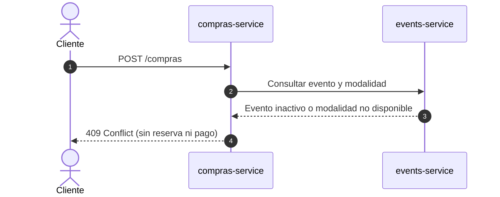
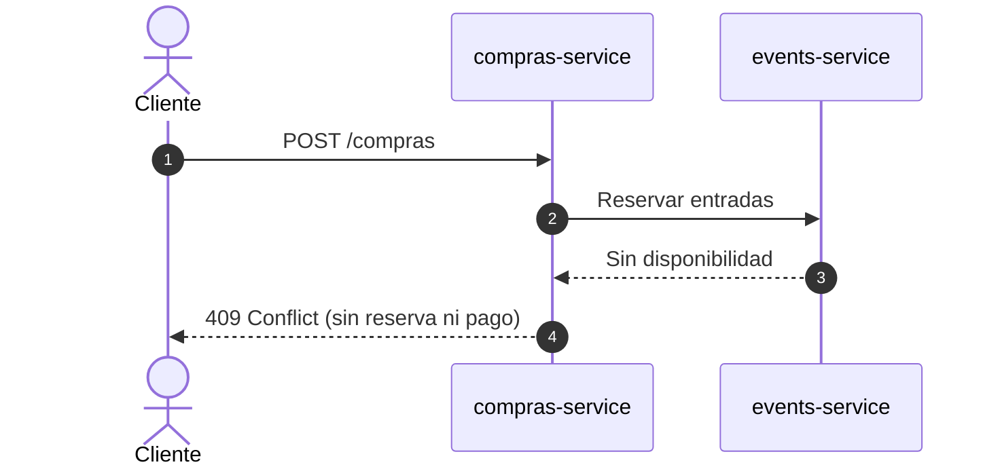
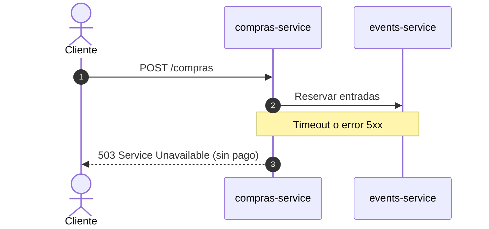
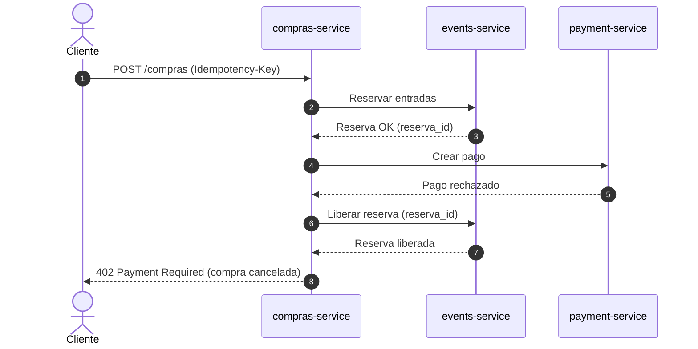
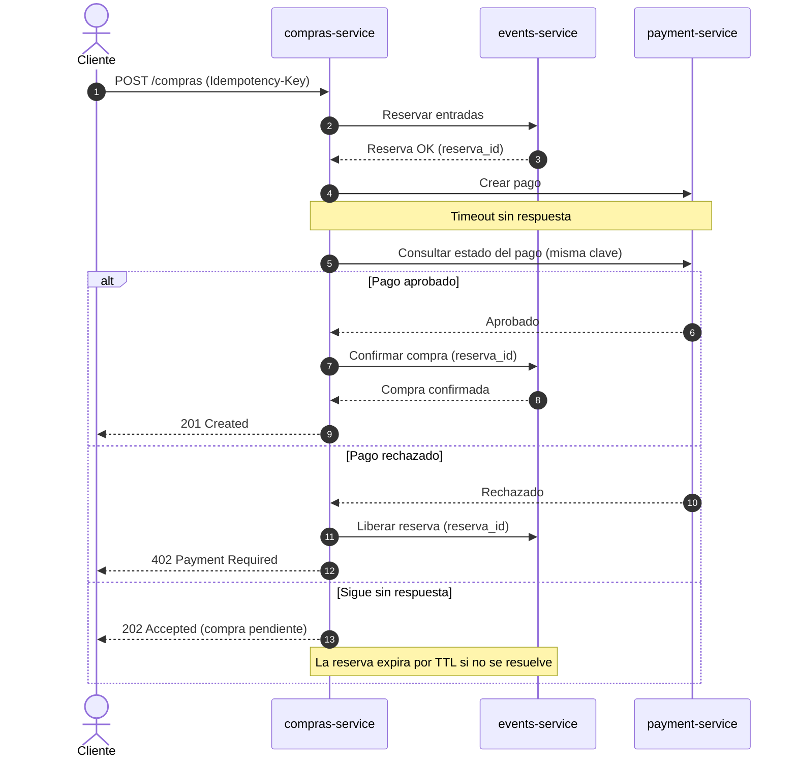
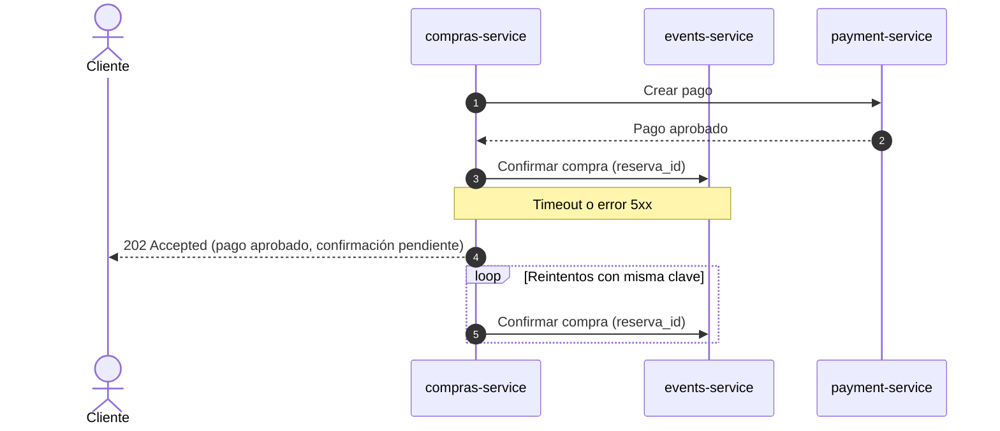
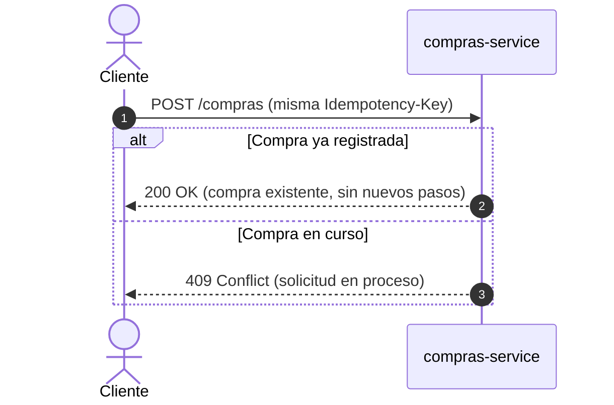
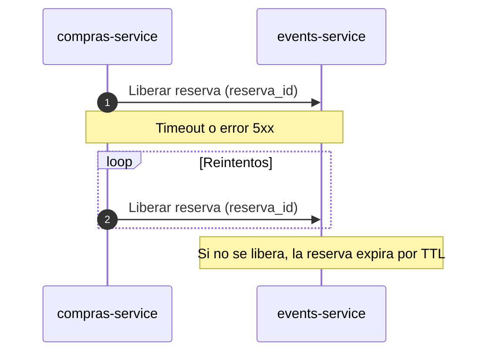

# ADR-0006: Flujo de compra completo con reserva, pago y confirmación

- Estado: Propuesto
- Fecha: 2026-11-18

## Contexto

La compra de entradas cruza tres servicios: `compras-service`, `events-service` y `payment-service`. El flujo objetivo es:

1. El cliente envía `POST /compras` a `compras-service`.
2. `compras-service` pide a `events-service` reservar entradas.
3. `events-service` confirma la reserva.
4. `compras-service` crea el pago en `payment-service`.
5. `payment-service` informa que el pago fue aprobado.
6. `compras-service` pide a `events-service` confirmar la compra.

Hay dos modalidades. La modalidad general se controla con cupo por modalidad. La modalidad numerada se controla con un mapa de asientos. La etapa actual de `compras-service` solo registra compras de modalidad general, sin cupo ni monto ([ADR-0005](0005-compras-consulta-eventos-e-idempotencia.md)). Este ADR fija el marco del flujo completo para ambas modalidades y deja explícitos los puntos que todavía no están decididos.

## Flujos de compra

### Flujo principal

### Fallas y flujos alternativos

#### A. Evento inactivo o modalidad no válida

Se rechaza antes de reservar. No hay reserva ni pago.

#### B. Sin disponibilidad en cupo o asientos

`events-service` rechaza la reserva. No se cobra.

#### C. `events-service` no responde en la reserva

Se responde 503 y no se inicia el pago.

#### D. Pago rechazado

La reserva se libera en `events-service`.

#### E. Pago sin respuesta (estado desconocido)

`compras-service` no sabe si se cobró. No libera la reserva a ciegas. Consulta el estado del pago con la misma clave y, si sigue sin resolverse, deja la compra pendiente hasta el TTL.

#### F. Confirmación falla después de un pago aprobado

El dinero ya se cobró, así que no se libera la reserva. La compra queda pendiente de reintento.

#### G. Reintento del cliente con la misma `Idempotency-Key`

No se reserva, cobra ni confirma de nuevo. Se devuelve el estado actual de la compra.

#### H. Falla la liberación de la reserva

La compensación se reintenta con la misma clave. Si no se completa, la reserva expira por TTL.

## Decisión

1. **Orquestación desde `compras-service`:** `compras-service` coordina el flujo. `events-service` y `payment-service` no llaman a `compras-service`. `compras-service` es el único servicio que conoce el estado global de la compra.
2. **Reserva antes del pago:** `events-service` reserva las entradas antes de cobrar. Así no se cobra por entradas que no se pueden entregar.
3. **Confirmación después del pago:** `events-service` convierte la reserva en venta solo cuando `compras-service` confirma que el pago fue aprobado.
4. **Idempotencia en cada paso:** cada llamada entre servicios lleva una clave derivada de la compra (`Idempotency-Key`), de modo que un reintento no reserva, cobra ni confirma dos veces.
5. **Modalidad como parámetro de la reserva:** la modalidad general reserva sobre el cupo de la modalidad; la modalidad numerada reserva asientos concretos. Cada modalidad tiene sus reglas (ver las secciones de concurrencia y entradas numeradas).
6. **Compensación:** si el pago falla o se rechaza, `compras-service` libera la reserva en `events-service`. Si la confirmación falla después de un pago aprobado, `compras-service` queda en un estado pendiente de reintento y no se libera la reserva hasta resolverla.
7. **Unicidad de venta por concurrencia:** `events-service` es el único responsable de que una entrada o asiento no se venda dos veces, aunque varios clientes compitan por el mismo recurso. `compras-service` no decide este mecanismo: solo reintenta con la misma clave.

### Concurrencia

- **Entradas generales (cupo):** la reserva descuenta del cupo con una actualización condicional en una sola sentencia (`UPDATE ... SET disponibles = disponibles - n WHERE disponibles >= n`). Si no afecta filas, responde 409, sin sobreventa.
- **Entradas numeradas (asiento):** la reserva usa una restricción única por (`evento_id`, `asiento_id`) o un bloqueo optimista con versión. Si otro cliente ya tomó el asiento, responde 409.
- **Mecanismo elegido:** actualización condicional o restricción única, no `SELECT ... FOR UPDATE`. El bloqueo pesimista queda como alternativa si el volumen lo exige (Etapa III, colas de venta).

### Entradas numeradas

- Cada asiento tiene un estado: `libre`, `reservado` (con TTL), `vendido` o `liberado`.
- Una reserva de asiento vence por TTL si no se confirma. Al vencer, el asiento vuelve a `libre`.
- La compra numerada referencia uno o varios asientos concretos, hasta el límite X por compra.
- Un conflicto de asiento responde 409, igual que el caso B del flujo.
- Las reglas de la modalidad numerada son distintas a las de la modalidad general: un asiento es único; la modalidad general tiene cupo.

### Compra por cantidad

- Una única compra puede incluir varios tickets de una modalidad: por cantidad en la modalidad general y por asientos concretos en la modalidad numerada, hasta un límite X por compra.
- La reserva es atómica: se reservan todos los tickets o ninguno. Si un asiento o el cupo fallan, se libera lo que ya se reservó y se responde 409.
- La idempotencia aplica a la compra completa, no a cada ticket: una misma `Idempotency-Key` no reserva dos veces el mismo conjunto.

## Puntos abiertos

- **Duración de la reserva (TTL):** cuánto tiempo dura una reserva sin pago y quién la expira. Pertenece al change de asientos y stock.
- **Límite X por compra:** valor, alcance (por compra, por cliente o por evento) y a qué servicio pertenece su validación.
- **Estados de la compra:** nombres y transiciones (por ejemplo, `pendiente`, `reservada`, `pagada`, `confirmada`, `cancelada`). Se definen en el design de `compras-service`.
- **Contrato de pago:** campos de `payment-service` y cómo informa el resultado (llamada síncrona o evento asíncrono). Se decide en el change de pagos.
- **Modo de comunicación:** las llamadas del flujo son síncronas en el diseño inicial. Migrar la confirmación del pago a un evento asíncrono queda para la Etapa III.
- **Devoluciones:** cómo se revierte una compra confirmada. Pertenece a la Etapa III.

## Consecuencias

### Positivas

- `events-service` es la única fuente de verdad de cupos y asientos.
- Un pago rechazado no deja entradas vendidas.
- Ambas modalidades usan el mismo orden de pasos y se diferencian solo en la reserva.

### Negativas

- El flujo tiene más pasos y más puntos de fallo parcial que el registro actual.
- La compensación debe ser idempotente y tolerar que el propio `events-service` no responda.
- Sin TTL definido, una reserva puede quedar bloqueada si el cliente abandona el pago.

## Alternativas consideradas

- **Cobrar antes de reservar:** se descarta porque obliga a devolver dinero cuando la reserva falla.
- **Coreografía sin orquestador:** se descarta porque reparte el estado de la compra entre tres servicios y dificulta saber en qué paso quedó.
- **Un único servicio para compra y reserva:** se descarta porque la reserva es parte del catálogo y el stock de `events-service` ([ADR-0003](0003-servicio-eventos-e-inventario.md)).
